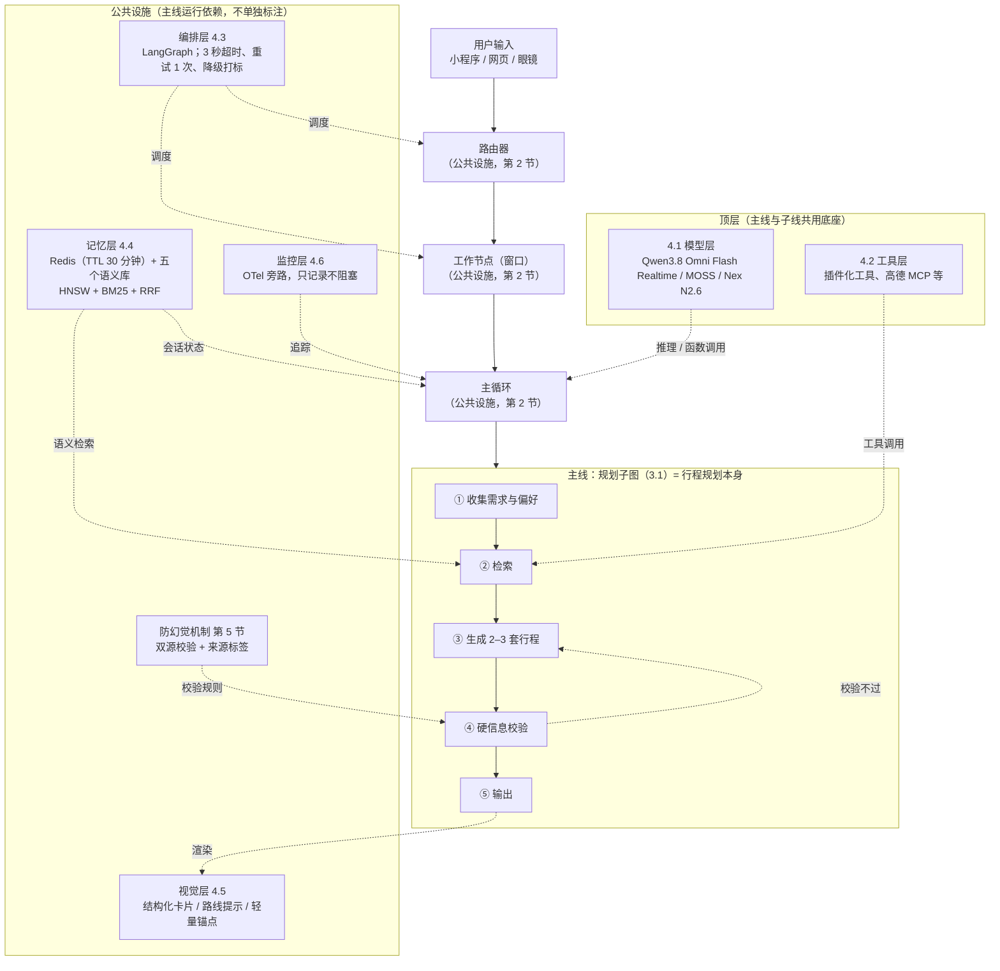
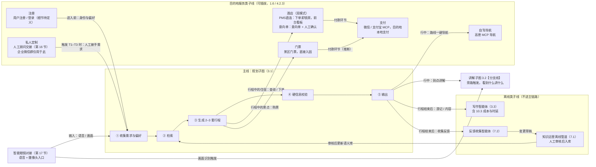

# V3 修订待办

更新时间：2026-11-16 15:47 台北时间（V3-1 记于 15:46）

> 只记录待办，不修改 `consolidated-spec-v2.md`、`odessia-spec.html` 或其他已有文件。待办在生成 V3 时统一处理。

## V3-1：10.3 成本与时延从主线相关表述中拿掉，明确归入子线（写作智能体）

- **类型**：待办（新增）
- **提出**：用户通话，按 mao789 的口径（2026-11-16 15:46 台北时间）
- **现状（v2 @ `bd24673`，1.5 节）**：
  - 「主线」一条下面列有两条子项，其中第二条原文为：「10.3 成本与时延出自写作智能体，改标为子线（见 D-11）。」
  - 这句话虽然写的是「改标为子线」，但它仍挂在「主线」一条之下，和「主线运行依赖的公共设施」那条子项并列，读起来像仍属主线相关表述。
  - 同一条「主线」的修订注里还保留原文「并把 10.3 成本与时延标为主线」（这是对旧定义的引用）。
- **V3 要做的**：
  - 把「10.3 成本与时延」这条从「主线」下面移走，放到「子线」下的「写作智能体（3.3，全文见 `writing-agent-spec.md`）」一条里，明确归入写作智能体这条子线。
  - 写明口径：成本与时延属于行程规划结束后的离线环节（mao789）。
  - 检查 10.3 标题标签（现为【子线 · 写作智能体】）、目录、D-6、D-11 及网页版 `odessia-spec.html` 对应处是否一致。
- **状态**：待处理

## V3-2：主线、子线章节各配一张架构图

- **类型**：待办（新增）
- **提出**：用户通话（2026-11-16 15:47 台北时间）
- **V3 要做的**：在 1.5 / 1.6（或第 2 节）主线、子线说明处各放一张架构图，草稿如下，V3 落笔时可直接使用。
- **口径说明**：
  - 按 v2 @ `bd24673` 的现行定义，主线只指规划子图本身；路由器、工作节点、主循环、编排 / 记忆 / 视觉 / 监控层、防幻觉机制是主线运行依赖的**公共设施**（1.5）。图里把它们画在主线周围，标为公共设施。
  - 讲解子图在 v2 里是**分支线**，不是子线；子线图里单独标为分支线。
  - 子线与主线环节的对应关系是本待办的整理（推断），V3 落笔时再核对。
- **状态**：待处理

### 图 A：主线架构图（草稿）

### 图 B：子线架构图（草稿）

### 子线与主线环节对应表（草稿）

| 子线 | 对应主线环节 | 作用 |
|---|---|---|
| 注册 | ① 之前 | 用户身份、历史偏好进入需求收集 |
| 私人定制 | ①（交接触发时） | 复杂或特殊需求转人工顾问，结果回写订单系统，规划子图读最新确认版 |
| 酒店（双模式） | ③ 生成 → 下单 | 住宿推荐后下单；按酒店配置走实时锁房或意向单 + 人工确认 |
| 门票 | ③ 生成 → 下单 | 行程中景区的门票，直接入园 |
| 支付 | 酒店 / 门票下单后 | 微信 / 支付宝 MCP，目的地本地支付，用户本人确认 |
| 自驾导航 | ⑤ 输出后（行中） | 把行程路线交给高德 MCP 导航 |
| 讲解子图【分支线】 | ⑤ 输出后（行中） | 旁路触发的景点讲解 |
| 智能眼镜对接 | ① 输入 / 讲解触发 | 第三个入口：语音输入、摄像头画面触发讲解 |
| 写作智能体 | ⑤ 输出后（行程结束） | 离线生成内容；10.3 成本与时延属于这一环（见 V3-1） |
| 反馈收集 | ⑤ 输出后（行程结束） | 收集纠错与评价，生成变更草稿 |
| 知识运营离线管道 | 反哺 ② 检索 | 人工审核后更新语义库 |
