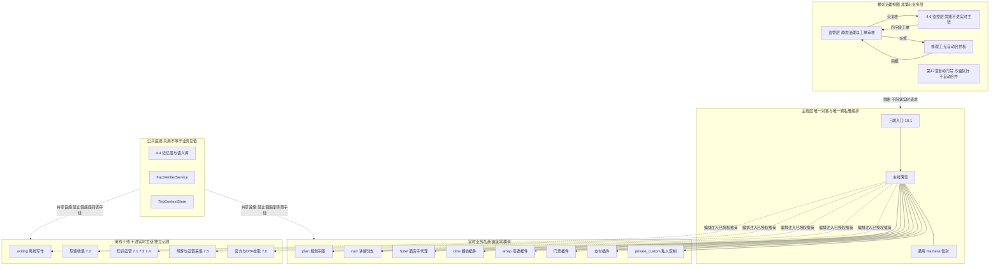
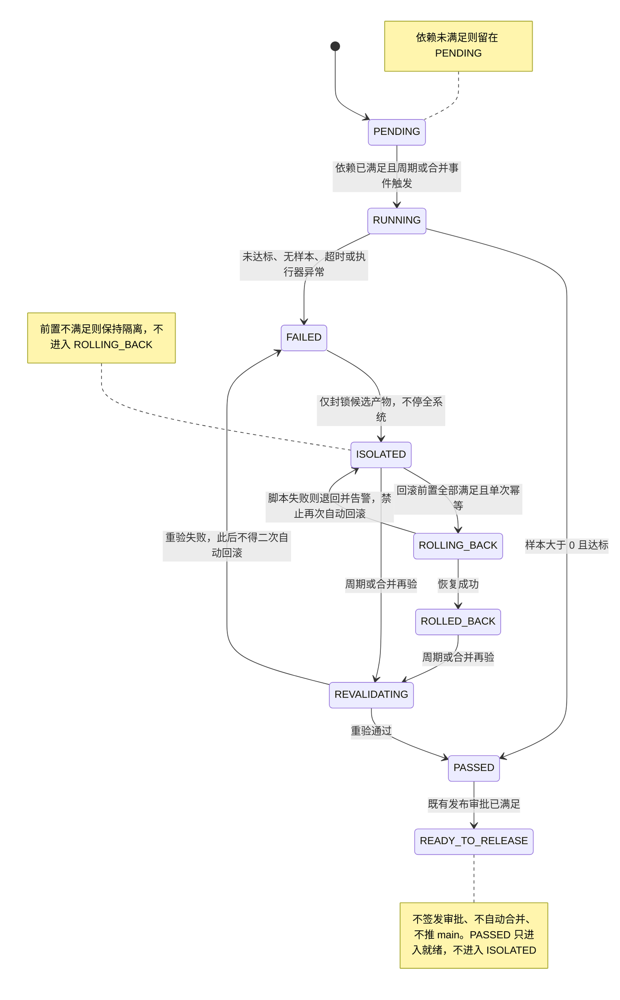

# 厦门版 Odessia · V3.1 开发规格

> 独立目标设计文档。原始底稿：`v3-architecture-part1.md`、`v3-architecture-part2.md`；细则参考：`consolidated-spec-v2.md`。三者均以提交 `9a8332fdaf5d34fd9e0db610ef8f349f39374a18`（简称 `9a8332f`）的只读快照为准。
>
> 本版在原 V3 架构上整合双层模型流水线、住宿双路径、主线编排与进度呈现、私人定制交接、共享授权快照与公共事实校验、本人确认后的酒店锁房，以及监管静态治理和旁路审计。上述七项已批准增补与原 V3 覆盖一并保留，不回退为待定。本版是新建的独立 V3.1 规格，不表示代码已完成、接口已接通、服务已部署、授权合同已签订、测试已通过或任何分支已合并。本版第 8 章纳入酒店与私人定制的 JSON Schema 契约及两项开发约定补丁；该契约不是原 V3 仓库已合并文件，结构通过也不表示业务已验证。
>
> 本增量在保留上述覆盖的前提下，补充分层职责视图、门禁双分支状态机、单次尝试超时与信封总截止拆分、交易确认约束、快照版本命名、离线名册以及讲解记录到回流之间的人工审核。分层四块是职责视图，不是新的第七业务层，也不改 4.1–4.6 或后续章号。约束按【原 V3 已定基线】、【本版采纳未验证】、【仍候选】阅读；架构图中未在正文单独采纳的额外候选不整包升格为基线或已验证能力。

## 0. 文档边界与引用

### 0.1 架构基线

原 V3 两部分共同构成开发前架构基线；本版以它们的完整职责和安全边界组织正文，不以 Rev 或审阅稿替代原始 V3。后续变更用增量、版本和决策记录追踪。v2、研究笔记和通话记录不是与 V3 并列的另一套架构基线；细则按本版指定的固定提交读取，不随 `main` 自动漂移。

文中“合并规格”均指该固定提交下的 `consolidated-spec-v2.md`；“第 8/9/10/13/14/15/16/17 章”等章号，若未特别写明“本版”，均是该合并规格的章号。本版自有章节号用于组织独立正文，不重编号仓库内的文件或任务。

本版明确采用的新流程按本版正文执行；原基线未被这些新流程确定的待确认事项，仍保持待确认，不凭空补模型、阈值、权限、保存期限、接口端点或测试结果。`private-customization-spec.md` 只说明概念出处，不是现行私人定制流程，也不把已删除的私人定制章写回去。

### 0.2 交付与开发范围

本系统面向厦门（含鼓浪屿）目的地闭环，主线承接行程规划，讲解为行中能力，其余业务通过独立接口接入。具体业务范围、非目标、六层细则、防幻觉、评测、故障、消耗、合规、开发任务和门禁，沿用合并规格中与原 V3 相容的规定。

所有下单、付款、改单及对外发送须遵守本版的本人确认或人工确认边界。共享基础设施、设备连接成功、任务 ACK、信用担保成功，均不等于某项业务已经完成。没有核验记录、没有游客本人的确认或没有测试样本，不能写成成功或通过。

### 0.3 效力标签

正文和架构图中的约束按下列标签阅读，不得混称：

- **【原 V3 已定基线】**：固定提交 `9a8332f` 的两部分架构或合并规格中已经写死的约束、红线与验收门槛。研发必须遵守，本版不得打折或改写成待定。
- **【本版采纳未验证】**：已写入本版作为开发规则，但尚未经实现、接入或评测证据证实。开发按本版执行，不得写成已经上线或测试通过。
- **【仍候选】**：仍待产品或负责人拍板，或仅作为可选工程方向。不自动覆盖已定基线，不得当作现行门禁。

本版 1.4 的分层总图与 5.4 的门禁图是校正后的职责视图，用来核对调用关系和状态分叉。图上出现但正文未单独采纳的候选项（例如 PROTECTED 软归档定位、手机明信片卡、60 秒 VAD 自动休眠、国内第二搭配模型待定等）保持【仍候选】，不因入图而升格。

## 1. 主线薄壳与统一交互

### 1.1 三项职责

主线是薄壳，只做三件事：

1. **语义意图识别**。由负责规划交互的同一个模型自己判断，不另设关键词清单、分类组件或第二个意图模型。
2. **行程规划的交互、发起编排和呈现**。规划能力本身由规划子图提供；主线不把规划算法再实现一套。
3. **视觉呈现**。把已经取得的结果呈现给游客。

壳内不塞各业务实现。需要酒店、餐饮、地图、讲解、写作或私人定制的结果时，主线分别通过接口调用对应工具或子代理，拿回独立结果，再形成对客呈现。业务检索、抓取、维度抽取等由对应业务内部承担。

主图进入规划或讲解的路由仍按合并规格第 3 章的写死规则执行；前端显式按钮事件（例如切换导航方式、否认当前建筑、接受或拒绝私人定制）同样映射到确定性处理，不让模型猜车间。【原 V3 已定基线】语义识别只用于规划对话内是否推荐私人定制，覆盖不了这条硬路由。界面事件及业务信号依统一接口进入主线，不新增一个意图分类模型。

### 1.2 双层模型流水线

| 环节 | 职责 | 模型与边界 |
|---|---|---|
| 实时前端与规划对话 | 实时语音输入输出、语义意图识别、槽位交互与函数调用；先作简短口语确认，再组织任务 | Qwen3.8 Omni Flash Realtime；与负责规划交互的主线模型共用，不另起意图模型 |
| 规划子图 | 槽位状态与约束检查、检索、方案生成、硬信息校验 | 子图提供规划能力，主线不复制内部算法 |
| 行程内容生成 | 根据模板、已确认槽位、检索及校验结果形成结构化行程内容 | Qwen4-Max，API model id `qwen4-max`；在采用前通过合并规格 4.1 的固定场景评测，未通过不得作为生产已启用 |
| 一般语音备用 | 主模型语音不可用时的合成与转写通道 | MOSS TTS + 转写；不是规划内容生成的备用强模型 |
| 其他备选 | 按客户要求或故障条件切换 | GPT Realtime / Gemini Live；切换仍须重新过合规，主备触发及回切顺序沿原未定范围处理 |

Omni 负责对客问答和槽位交互，规划子图负责槽位约束及规划处理；Qwen4-Max 是内容生成阶段的强模型，不成为另一个意图识别器，也不直接替换实时语音通道。合并规格 4.1 中简单槽位提取小模型的具体型号仍未指定，本版不凭空指定；该待定项不取消当前主线的槽位交互职责。

Qwen4-Max 的评测包括 JSON Schema 合规、槽位硬约束遵守和异常输出；评分阈值仍待配置，不虚构分数。首字延迟与消耗可纳入评测，但没有实测就不写已达标。规划强模型的保底型号和完整降级、回切顺序仍待定义，MOSS-VL-Realtime 不用作规划备用。

### 1.3 主线交互与私人定制推荐

游客在规划对话里表现出行程太累、想省心或不想自己动脑时，主线推荐私人定制，并以会话状态切换承接。状态切换后，游客看到的界面仍在主线；游客可以接受、拒绝或切回规划。

推荐、状态切换和前端显示联系入口都不是自动发消息、签约、下单或付款。私人定制的具体承接、顾问联系卡、进度看板和一期人审发送，见本版 3.6。

### 1.4 分层职责视图与主线唯一编排

系统按四块职责视图组织，口令是「横切监管与门禁 + 主线薄壳唯一编排 + 子线零交叉依赖 + 顶层/公共设施共享」。共用底座不等于业务互依。这四块是视图，不是新的第七业务层，也不把监管层或门禁编号为 4.7。

1. **横切治理**【原 V3 已定基线】：第 4 节监管层与 4.6 监控层并列；第 17 章自动门禁执行智能体在沙盒执行评测与隔离。4.6 只发现、打标、上报，不承担修复，不进入游客实时请求同步调用链。监管层审核四字段工单后派修理工，修复回报后再交 4.6 复核；修理工和门禁都没有自动合并或发布权。门禁通过支路是 `PASSED → READY_TO_RELEASE`，不得把 `PASSED` 连入 `ISOLATED`。状态机详见本版 5.4。
2. **主线薄壳**【原 V3 已定基线】：唯一对客协调壳，也是唯一跨名册编排发起方。三项职责仍是语义意图识别、发起规划与各子线编排、组装视觉呈现。硬路由是进入车间的写死规则，不改写这三项职责的划分，也不另设第二意图模型。三端入口（16.1：电脑网页、微信小程序、智能眼镜适配器）进入主线；设备连上不等于业务完成。
3. **实时业务名册**【原 V3 已定基线】：`plan`、`narr`、`hotel`、餐饮插件 `dine`、高德插件 `amap`、门票插件、支付插件、私人定制 `private_custom`。彼此零交叉依赖，一律由主线经通用 harness 调用并交回结果。`dine` 与 `amap` 保持插件形态，不升格为独立语言模型代理。支付必须由游客本人确认，AI 不代付；规划子图不得调用支付工具。`private_custom` 是实时同级子代理，不与离线写作画成同一个节点。
4. **离线子线**【原 V3 已定基线】：写作 `writing`、反馈收集（7.2）、知识运营管道（7.1 / 7.3 / 7.4）、导游与运营采集（7.5）、官方与 OTA 定时拉取（7.6）。它们不进入游客实时主链路，独立记账，不得横调其他业务子线；所需已授权输入由主线或编排层注入任务载荷。7.5 的「实时采集」指作业采集，不把该子线并入 14.2 端到端计时。7.6 不得绕过 4.2.2 关于不抓取携程、美团评论的限制。

下列总图是对上述文字的校正绘制，已拆开 `private_custom` 与 `writing`，并把 4.6 放在横切旁路而不是混入底座业务框。源 SVG 只作对照，本版以本节与 5.4 的 Mermaid 为准，不修改源文件。

主线分别编排、汇总各自结果；实时名册与离线名册内部都没有横调箭头。`TripContextStore`、公共事实校验和基础模型属于共用底座。Qwen4-Max 仍只在规划内容生成阶段使用，且须先按 1.2 完成评测再采用，不画成另一条意图路由。

## 2. 子线独立、通用契约与监管

### 2.1 独立边界

除监管层外，业务子线彼此零交叉依赖。可以共用通用 harness 协议、基础模型和基础设施；共用这些不等于业务上相互依赖。

一条业务子线不能直接调用另一条业务子线，也不能把另一条的完成当成自己的前置条件。主线通过接口编排，分别拿回各自结果。规划需要酒店、餐饮、高德的业务结果时，由主线分别发起调用并将结果注入规划任务；规划子图不直接调用这些业务子线。

公共检索基础设施、公共事实校验服务和共享授权快照可以复用，但不能借公共设施之名转调另一条业务子线。餐饮、高德仍是插件，不因此升级为独立语言模型代理；酒店是独立子代理，插件是它暴露给主线的接口和适配。

合并规格第 13 章的开发任务先后是开发顺序，不是运行时子线依赖；开发图不能被当成子线必须互相调用的图。市场能力也沿用共同接入契约，不因独立迭代而绕过验收或权限。

### 2.2 通用 harness 契约

子代理接入沿用已有通用 harness，不另立一套连接或传输协议：

- 信封使用已有 `task_id`、`trace_id`、`loop_id`，不另造请求号。业务载荷 schema 按接口版本注册；不同业务可以有不同载荷，共用信封、调用生命周期、错误处理和版本协商。
- 合并规格 4.3 的共享消息字段仍为 `task_id`、`input`、`output`、`status`、`latency`；追踪元数据与业务字段的层次保持清晰，`task_id` 不代替 `trace_id`，跨异步闭环用 `loop_id`。
- 信封另含接口 schema 版本、幂等键，以及按本版 2.3 拆分后的单次尝试超时与信封总截止；适用时携带分片顺序与数量。不把一次工具的超时值当作写作等离线业务的完成时限。`schema_version` 只表示接口契约版本，与行程快照的 `version` / `confirmed_version` 不是同一字段。
- 收到完整且校验通过的信封，才给出明确 ACK。确认不了，状态是失败或未知，不假称成功。任务提交及 ACK 与异步业务完成是两件事。
- 副作用状态未知时先查询已有确认状态，不盲目重复下单；重试按幂等键去重。不声称传输已经做到恰好一次或网络永不故障。
- 不静默丢弃，不把截断、乱序或不完整的半包当成成功消费。`partial` 只用于信封完整、校验通过且明确注明降级原因的业务结果，不表示损坏半包。
- 语音可在帧序验证后逐段播放，但必须有帧序号、结束标识和完整状态；没有结束标识的流不算成功。
- 版本兼容沿用已有规则：新能力优先做兼容增量；破坏兼容才采用新版本，并保留主线可显式选择的旧版或适配器。版本号、兼容天数和迁移窗口不在本版补造；迁移先协调，不无通知强切。
- 设备是否连上、担保是否办成，都不是业务本身已经完成。这些是设计要求，不是已接通的接口。

通用错误沿合并规格第 9 章：`timeout`、`empty`、`invalid`、`denied`、`ratelimit`、`upstream`、`stale`、`partial`。失败返回至少保留 `error_code`、`error_class`、`retryable`、`next_action`、`status`、`source`、`timestamp`、`trace_id`。无来源或时间戳的硬信息不得标为已确认。

稳定用例沿用 `FM-{hotel|dine|amap|plan|narr}-{模式}` 的 45 个既有 ID；私人定制和写作不新造专属 FM 组件、业务交接编号或任务号。harness 记录沿用关联业务的最短必要保留规则，不向游客暴露内部记录。

酒店与私人定制的业务载荷 Schema、动作精确枚举，以及本版补上的动作-载荷绑定和成功推荐卡片数量规则，见本版第 8 章。实现字段表、校验伪代码与待执行用例见独立开发准备文档 `/workspace/sub-agent-dev-schema.md`。该 Schema 只校验信封与 JSON 结构，不代替运行时授权、幂等、回查或外部能力实测，也不构成业务子线互调。

### 2.3 共享重试预算、超时拆分与原有术语待统一

原 V3 的明确表述保留：**“重试预算与已有规则共用：同一请求最多 2 次，不在传输层或 SDK 上再叠一轮。”**

固定细则中，4.2.9、第 9 章等执行条文写明：每次工具调用超时 3 秒；首次失败或超时结束后，按单调时钟固定等待 1 秒，再重试一次；同一请求最多 2 次调用。适用请求、组件和错误类按第 9 章，不由 SDK 或传输层另加一轮。

本版将「单次尝试超时」与「信封总截止」拆开，避免用同一个字段既表示 3 秒尝试又表示整段重试窗口。【本版采纳未验证】命名与本章第 8 章保持一致，不另造第三套字段名：

- `per_attempt_timeout_ms`：单次尝试超时。对适用第 9 章「每次工具调用超时 3 秒」的同步工具情景，固定为 3000。它是本版开发约定的调用配置；若写入信封，只作声明，不是源 Schema 已有的必填项，也不得用它冒充总预算。
- `deadline_ms`：信封总截止，由调用方按本次预算显式传入。对适用「最多 2 次调用 + 中间等待 1 秒」的可重试同步工具，默认总预算必须足够覆盖 3 秒 + 1 秒 + 3 秒情景，建议默认不小于 7500 毫秒。不把 7 秒或 7500 毫秒写成所有工具、所有动作或端到端行程的固定时限；不可重试的短调用可以把总截止设得更紧，离线写作等不得套用该同步工具预算。
- 单次工具在两次都耗满 3 秒再加 1 秒等待时，是该次调用的 7 秒情景，不是端到端保证，也不放宽 14.2 完整行程验收。

`invalid`、`denied` 及其他 `retryable=false` 不重试。限流时遵守服务端 `Retry-After`，但仍受本次 `deadline_ms` 总预算约束，不在传输层或 SDK 上再叠一轮重试；若 `Retry-After` 会超过剩余总预算，不得为等待而撑破信封截止，应在本次调用降级或安排截止之后的稍后重试。

**TBD：统一口径。** 同一固定细则的 8.5、17.2 另有“重试总数不超过最多 2 次”的表述，与“重试一次、最多 2 次调用”存在次数术语混用。本版保留上述原始明确表述和出处现状，不自行改写任一源文，也不据此增加调用预算；开发配置和对应验收用例的统一文字仍须确认。

本版第 8 章信封字段 `harness_meta.attempt` 取值为 1 或 2，表示同一请求最多 2 次调用，与本节「首次失败后再重试一次、最多 2 次调用」对齐；不改写本节已保留的原始表述，也不增加调用预算。术语统一仍按本节 TBD 处理。

### 2.4 监管层与 4.6 监控的分工

监管层是唯一共同治理约束，横跨业务节点，与合并规格 4.6 并列，是横切治理，不是第七业务层，不改变 4.1–4.6 或后续章号。它检查同一能力是否重复建设、同一事实在不同子线是否说法一致，不代替主线编排，也不允许业务子线互调。

本版把监管实施职责分为两部分：

| 部分 | 职责 | 边界 |
|---|---|---|
| 研发期静态治理 | 开发前冗余与规格一致性检查；开发中代码冗余审查；评估新框架并记录采用理由，供人工审查 | 采用理由进入第 15 章式决策记录；发现漏洞后的修复须经人审核，不自动合并或发布 |
| 运行时旁路审计 | 消费 4.6 观测与标准工单，检查失败后卡死、重试异常、重复能力及跨子线硬事实不一致；审核后派修理工 | 不进入游客实时请求同步调用链，不阻塞主线；诊断、建议或告警不是执行授权 |

4.6 仍负责运行时观测：进出节点、工具与模型调用用 OTel 旁路记录；只发现、打标并上报，不承担修复。4.6 与监管层并列于横切视图，是旁路而不是主线同步步骤，也不画成第 2 层业务框。标准工单沿用 `trace_id`、节点名、错误类型、复现条件四项。监管层审核、派修理工，修复结果回报监管，再交 4.6 复核闭环；修理工没有自动合并、发布或扩大权限的授权。

监管层可以提出项目级质量与优化建议；建议不直接改业务代码，也不构成自动发布。运行时审计消费已有追踪和工单，不凭空宣称已建专用队列、阈值、SLA、模型或工单系统。

从本规格写代码之前，冗余检查与规格一致性检查先就位，开发开始时提醒提出人；这不表示必须先完成整套自动监管。原安全工具候选仍仅供开发阶段评估：Snyk Agent Scan、promptfoo、NVIDIA garak、NVIDIA NeMo Guardrails、Microsoft PyRIT。未评估不表示已采用或安装，也不在本版指定它们全部成为必装依赖。

## 3. 子线名册与业务流程

下列各项保留原 V3 子线名册位置。实时名册为规划、讲解、酒店、餐饮、高德、门票、支付与私人定制；离线名册为写作、反馈收集、知识运营、采集与拉取，见 3.7。讲解代号仍为 `narr`；餐饮、高德、门票与支付是插件；眼镜适配器只做输入输出转换，不是新的业务子代理。私人定制与离线写作必须作为独立节点，不得画成同一框。

### 3.1 酒店：双模式、草稿与本人确认

#### 3.1.1 配置与共同边界

酒店沿用合并规格 4.2.1 的业务政策和 4.2.2 的 12 项推荐维度，不另造一套推荐政策。按每家酒店配置走 `PMS直连` 或“意向单 + 人工确认”；两种都允许，每家选用对应模式，不是每笔必须两种一起走。

AI 永不自动下单、自动付款或绕过人工确认。酒店前台不装 AI，只看结果性的实时房态看板：入住人、房号或房型、入住和离店日期、确认号。实时价格、可订性和取消政策须实时取得并按硬信息规则校验；超时不把缓存历史报价当成当前报价。

本版确定下单授权和锁房的业务先后为：**AI 生成不扣库存的草稿 → 游客本人在前端显式点击确认 → 后端校验签名 token → 按酒店模式提交锁房或意向单 → 本人确认支付。** 该流程承接原基线中锁房与确认先后待决定的部分，供应商具体接口、授权开通及交易异常恢复仍按本节前提处理，不表示已接通。

#### 3.1.2 AI 推荐与草稿阶段

主线通过酒店子代理取得结构化酒店卡。酒店对主线交最终结果，业务内部检索和维度提取仍由酒店子代理承担。

当游客口头表示想订某家酒店时，AI 仅形成 `BOOKING_DRAFT`，通过 `hotel.prepare_booking_draft` 对应的任务能力返回 `BOOKING_DRAFT_CARD`。草稿卡展示房型、入离日期、经校验的实时价、取消政策和模式标识 `PMS_DIRECT` 或 `INTENT_ORDER`。

此时不扣库存、不调用 PMS 锁房、不生成正式意向单，也不发起支付。`hotel.search_and_rank`、`hotel.prepare_booking_draft` 是本版定义的内部业务接口名称，通过既有 harness 承载，不是新传输协议或已经接通的供应商 API。

上述内部名称与源契约动作枚举的对应关系见本版 8.2；推荐张数、下单凭证与超时禁价的结构约束以第 8 章为准。

#### 3.1.3 游客确认与模式分流

仅当游客本人在小程序或网页亲自点击“确认锁房 / 提交意向单”按钮时，前端提交 `user_action_token`，后端网关验证签名及相应的本人确认记录后分流。AI 推荐和口头倾向不直接触发这一步，AI 不代游客点击。

| 酒店模式 | 本人确认后的流程 | 结果状态 |
|---|---|---|
| `PMS_DIRECT` | 后端调用已获授权的 PMS 锁房接口；锁定成功后前台看板对应房间变红，并显示 15 分钟支付倒计时 | `LOCKED_PENDING_PAYMENT` |
| `PMS_DIRECT` 支付 | 拉起微信/支付宝本地支付环节，由游客本人在通道内确认付款；付款成功后形成确认 | `PAID_CONFIRMED` |
| `PMS_DIRECT` 超时未付 | 15 分钟支付倒计时结束仍未付款，自动解锁、释放房态 | 不把释放后的房态记为已确认订单 |
| `INTENT_ORDER` | 生成正式意向单，人工运营向酒店确认房态与价格后回传；再由游客本人在微信/支付宝完成本地支付 | `INTENT_SUBMITTED`，付款成功后为 `PAID_CONFIRMED` |

本人点击提交请求不等于酒店已锁房，支付界面已拉起不等于付款成功，工具 ACK 不等于业务完成。未确认的结果按通用契约记失败或未知；副作用未知先查询确认状态，不能盲目重复下单，也不能展示成 `PAID_CONFIRMED`。

通道权限、PMS 锁定与解锁接口、付款结果核对、取消或人工确认未通过时的恢复，以及付款与释放结果发生异常交错时的处理，需酒店与支付接入契约明确；本版不编造外部权限或回调端点。不得在这些前提未满足时声称流程已经上线。付款始终由本人确认，规划子图不能调用支付工具。

#### 3.1.4 交易确认约束（本版采纳未验证）

本节是开发必须遵守的正面规则，用于补齐本人确认与支付结果核对，不表示签名算法、通道冲正接口或供应商能力已经接通，也不引述历史审阅评语。

1. **登录身份绑定**。确认锁房、提交意向单或支付确认，必须绑定当前已登录游客身份，且与该草稿所属游客一致；身份不一致则拒绝，不得完成锁房、意向单或付款确认。
2. **房型与金额快照绑定**。本人确认凭证必须绑定该次草稿的房型与同意金额快照（至少包括 `room_type_id` 与 `agreed_price_cny`，以及入离日期）。房型或金额已经变化时，原凭证失效，须重新生成草稿并再次由游客本人确认。
3. **一次性防重放**。`user_action_token` 或等价本人确认凭证只使用一次；重复提交视为重放并拒绝，不得再次锁房或再次记为付款成功。验签、一次性核销和身份与快照核对是运行时查证，JSON 有字段不等于已经通过。
4. **迟到支付补偿**。15 分钟倒计时结束后的自动解锁、释放房态或取消之后，如果才到达支付成功回调，不得把已释放房间记为 `PAID_CONFIRMED`。必须先查已有确认态与当前锁房状态，再走补偿、冲正或人工核对路径；禁止在已释放或已取消的订单上重复确认付款。具体通道冲正接口仍待接入契约明确，不在本版虚构端点。

15 分钟支付倒计时仍按 3.1.3 执行，不回退为待定。

### 3.2 餐饮、高德、门票与支付插件

餐饮是插件；高德（`amap`）是插件。它们向主线返回各自查询或路径结果，不成为独立语言模型代理，也不直接调用酒店、讲解、写作或私人定制。主线分别调用，再将结果用于规划、对客呈现或任务载荷。路径 A 的坐标解析、多方案路网对比，以及餐饮、酒店结果的交叉校验，均由主线发起对 `amap` / `dine` / `hotel` 的调用，规划子图不得自行横调这些入口。

餐饮保留自建库优先、外部兜底的规则；高德承担既有 POI、地理编码与路径结果能力。业务调用只经主线，不把规划子图和酒店、餐饮、高德串成业务互调链。

导航沿用合并规格 4.2.3【原 V3 已定基线】：由游客在两种方式中选择其一，不得由系统擅自只保留一条路径。其一是页内路网呈现，用于路网、算路、标点和语音引导，不是逐向导航引擎；其二是深链唤起高德 App，提供完整逐向导航。这是规格要求，不是已实现声明。

门票插件与支付插件同属实时名册中的插件，不升格为独立语言模型代理，也不横调其他子线。本地景区门票的供应渠道与检票方式仍待确认。支付为微信支付 MCP 与支付宝 MCP 的目的地本地支付，必须由游客本人确认，AI 绝不代付。

### 3.3 规划：槽位、住宿双路径与交付

#### 3.3.1 规划职责与输入

这里的规划就是合并规格 3.1 的能力，不是再造一条主线。主线薄壳负责规划对话、发起编排与呈现；同一个规划交互模型做语义判断，不另起意图模型。规划子图负责槽位、检索、方案生成和硬信息校验，主线不复制这套算法。

进入规划后，四槽位按住宿优先收集：天数、住宿位置（先问，作为出发基准）、预算区间、同行人群。住宿位置已经给出或已走路径 A 确认时，不再把住宿当作未答项重复追问；其余已给的信息同样不按清单重问，只追问尚未提供的槽位。一次只追问一项；沿用合并规格的追问规则及其待验证范围，不另定轮次数字。

槽位、兴趣、默认假设与待补齐状态明确区分。未知项不写成已落实，未经用户确认不暗填预算、人群或兴趣；已确认硬约束不被默认值覆盖。槽位依赖、超预算、搜不到与中途改条件，沿用合并规格 3.1 的明确输出和局部重检规则。

#### 3.3.2 住宿双路径

**路径 A：已经订酒店或已明确住宿点。** 主线调用高德插件 `amap` 取得住宿 POI 与坐标，将 `slot.accommodation = { status: "confirmed", poi_id, coord, zone }` 注入规划任务。`poi_id` 与 `coord` 是工具返回的硬事实，必须带来源；禁止主线或规划子图凭空编写坐标，也禁止把未经工具核验的文本地址直接当成已确认坐标。规划子图以该点为 `origin_anchor`，先检索经典线路模板，再按远近顺路和实际时间路径约束调整站点。

**路径 B：尚未订酒店或住宿待定。** 住宿先标待补齐或 `pending_recommendation`，不暗用市区中心冒充已确认住宿。主线在取得可用预算、人群等条件后，前置调用酒店子代理，取得 2–3 个推荐片区的合作酒店候选卡；其他任务可在前提满足时由主线分别并发编排。

规划子图使用主线注入的酒店候选，以各候选所在片区作为对应方案的临时基准 `candidate_origin_anchor`，生成“候选酒店 + 对应顺路行程”组合方案。卡片明确标注“住宿待补齐：当前按候选酒店片区排程，选定酒店后自动校准路线”。选定住宿后的费用、时间和路网重新校验，候选不自动成为已确认住宿。

条件不足、酒店无候选或调用失败时，按已有待补齐、追问、失败或降级规则明确输出，不凭空填造酒店、POI、价格或偏好。酒店候选由主线交给规划，规划不直接调酒店、餐饮或高德业务子线。

酒店检索在 `status=ok` 时必须返回 2–3 张真实推荐卡；不足 2 张不得凑造或用联盟深链充数，须返回明确的非成功状态，见本版 8.3。该规则只约束成功推荐，不要求非检索动作附带推荐数组。

#### 3.3.3 生成、校验与方案选择

规划内部处理模板和槽位约束，结合主线提供的业务结果生成严格结构化 JSON 行程，再经过硬信息校验。Qwen4-Max 用于内容生成阶段，并受本版 1.2 的评测采用条件约束。

默认采用主推与备选的展示方式，通常提供 2–3 套真实可用方案；没有足够可用方案时，有几套给几套并说明不足，不为凑数虚构第三套或任何不可用方案。用户选定的一套成为后续微调基准，未选定方案不写成已确认行程。

输出包含槽位落实状态、兴趣或待补齐状态、每日站点时段与路网、费用区间、来源、时间戳、校验状态、异常及未解决项。硬信息未知、无来源或无时间戳，不标成已确认。完整交付须四槽位落实、硬信息校验通过且没有未解决异常；否则明确标为部分或待补齐输出。

校验不通过时先局部替换同类同区域候选并按既有规则重验，仍不通过则移除该项并说明原因；删站后重检当日时间与路径，不静默整套重算或丢掉已确认偏好。用户改条件也只更新被改槽位，必要时做相关时间、费用和路线重排。

行程质量沿用合并规格：节奏合理、通勤与时间可行、体验文化休闲优先、不含购物类推荐或安排，代码校验优先于模型自由生成。景点是可替换的推荐项，不变成强制必去项。兴趣须来自游客，不凭空强配。

#### 3.3.4 进度展示与异步校验回填

1. **即时口语确认**：Omni 先流式返回简短自然确认，再进入检索和生成；不提前播报未经校验的价格、库存或其他未证实硬信息。
2. **骨架进度展示**：主线可用模板或片区预渲染结果展示进度卡片和地图框架。待校验硬字段留空或显示 `verifying`，不作为已确认推荐、可订承诺或完整交付。
3. **主线编排与回填**：主线分别取得酒店、餐饮、高德等结果并组织规划校验；校验通过后可经 SSE 增量更新卡片，显示 `verified`、来源与时间戳。酒店对子代理接口仍交完成结果，不要求它对主线逐维流式输出。

**骨架展示仅为进度提示，不替代完整、可用的结构化行程交付完成条件。**

进度通道、harness 提交 ACK 与完整业务完成分开；出现超时、过期或失败，按既有组件规则打标与降级。酒店超时不得把缓存历史价回填成当前报价，损坏半包不算 `partial`。

### 3.4 讲解、设备、可选租赁与意图返回

#### 3.4.1 讲解触发和职责

讲解沿合并规格 3.2，代号仍是 `narr`。它是讲解能力，不是新的业务代理，也不是规划的拷贝。只在行程中游客明确想听导览时开启；不想听，就跟地图走。戴着眼镜、到达点位或摄像头看见景物，不因此自动连续讲解。

讲解保持一次触发、一次检索、一次生成、一次输出的业务流水线，不承担运行时知识库进化。原检索侧重、语音主通道和视觉辅助，沿用讲解细则，不将本版共享设施变成复制一套规划。

#### 3.4.2 手机、眼镜与适配名册

手机加耳机与智能眼镜并列，不以租赁作为听讲解的前提。游客使用自己的手机耳机，或已列入预接入名册的第三方眼镜，不走租赁，也不做信用担保。

游客说出品牌和型号，用一句话选择并启用；摄像头和麦克风须先获授权。未适配、连接失败或未授权，不能说已经一句话连上，应回退手机耳机或只跟地图走。

预接入名册是设计要求，不是已经接通或厂商均已开放接口的声明。候选称谓按用户原词保留：**灵伴、狸鸟、Meta、Huawei、Xiaomi**。狸鸟是否就是雷鸟待核验，不擅自改名。型号、SDK 官方身份、开放权限及版本兼容待核验；名册记录品牌、型号、SDK及其版本、适配状态、授权能力。版本未核验留空或标待核验，适配状态未核验不写已接通，不虚构版本、端点或测试结果。

眼镜适配器只把设备输入转成 `narr` 可用形式，再将同一份语音结果送回该设备；它不是独立业务子代理，各设备共用一份 `narr`。摄像头默认关闭，只有讲解已开启且游客授权后才识别当前上下文，不能由取帧反过来开启讲解。

消耗只记在第 10 章的 `narr` 账上，不因换设备重复计费，不恢复金额停机硬上限。设备已连接不等于讲解已完成。

#### 3.4.3 公司自有眼镜的可选租赁

公司自有眼镜可以另作可选租赁，与第三方适配名册及一句话启用分开。只有游客主动选择租公司眼镜时，才须以支付宝信用或微信信用担保，不要求人人租赁。

本版不指定信用产品、接口、信用分、押金、免押资格，不声称已开通合作或签约。通道实际开通且游客在支付宝或微信内自己确认授权后，才把担保记成功；未知或失败不是完成。AI 不代授权、签约、付款，也不自动下单。

#### 3.4.4 讲解意图返回主线

游客在讲解中提出改行程，例如因太晒想把室外景点换为室内点时，`narr` 不自行改路线，也不调用规划子图、酒店、餐饮或高德业务子线。它把逃逸业务信号随已获授权的当前任务上下文返回主线。

【本版采纳未验证】该信号放在业务 `output` 中，推荐字段为 `output.routing_hint`，取值使用已有业务信号 `INTENT_ESCAPE_TO_MAIN`，并可同时携带 `plan_modify` 上下文。`status` 仍只能是 `ok`、`partial`、`no_exact_match`、`failed`、`unknown` 五值之一；典型做法是合法 `status="ok"` 并在 `output` 给出逃逸提示。禁止把 `escape_to_main` 或任何逃逸名称新增为第六个信封状态。

主线读取 `output` 中的该提示后，切回规划微调交互，分别编排需要的结果并调用规划子图，只调整受影响部分，再校验相关费用、时间与路线。不另造连接协议，不新增意图模型，也不把新业务信号无通知强加给旧接口。

#### 3.4.5 在线记录与离线回流之间的人工审核

【原 V3 已定基线】V3-10 要求讲解相关的在线轻量记录智能体与离线回流智能体之间，必须隔开一道人工审核，防止未审数据进入正式知识库或回流产物。在线记录不直接写入离线回流，离线回流不绕过该审核墙自动吸收在线记录。审核未通过的内容不得当成已确认知识。具体审核队列、时限和工具仍按原细则与待配置项处理，本版不虚构已接通的审核系统。

### 3.5 离线写作与共享授权上下文

#### 3.5.1 写作边界

写作沿合并规格 3.3 及 `writing-agent-spec.md` 的相容细则，是离线子线，独立记账，不占主线端到端 P95。它不直接调用其他业务子线。所需且已经授权的输入，由编排方打包进本次任务载荷。

行程对象和订单提供硬事实；素材使用遵守逐项同意、最小使用和可撤回。行程记录、媒体或私人定制资料可被某项业务合法使用，不自动扩大成写作、长期画像或训练授权。

写作生成和用户审阅不等于对外发布。写入公众号草稿箱也需要账号授权及逐篇确认；各平台逐篇逐平台确认后才执行对应交付或写入。默认公众号草稿箱、小红书内容包等按配套细则处理，不自动以游客名义发布。

#### 3.5.2 TripContextStore

本版采用 `TripContextStore` 作为编排方维护的共享授权行程快照，承载行程 JSON、酒店确认单摘要、讲解触发的建筑档案 ID，以及游客逐次授权的媒体素材 ID，并保留来源、确认状态及对应方案或订单版本。

【本版采纳未验证】快照的规范主键是 `(user_id, trip_id, version)`。这里的 `version` 是该行程快照自身的版本号，顾问提案与游客已确认方案可以对应不同的 `version` 行，不得混成同一条已确认记录。`confirmed_version` 是指向「游客已确认的那个 `version`」的引用，与 `version` 不是同物异名，也不能单独替代主键。提案版本与生效版本必须保持语义区别：未被游客确认的提案不得写成现行行程。该命名不影响 `harness_meta.schema_version`、门禁 `config_version` 或其他接口/配置版本字段。

行程用 `user_id` 与 `trip_id` 关联；`loop_id` 继续表示业务闭环，只作为审计外键之一，与 `trace_id`、`task_id` 保持原用途，不把一次调用链或 `loop_id` 当成行程主键。主线/编排层负责归集和提供授权快照，业务子线不通过快照直接调用彼此。

行程结束后，编排层从快照读取本次任务获授权的数据，形成 `writing_task_payload`，经共用 harness 投递离线写作。写作不为补素材直接请求酒店或 `narr`，不把未确认、缺失或过期数据伪装成既定事实。

共享不扩大读取范围：不同游客的记录不互通；授权用途、缺失区间、撤回和保留期限随关联业务处理。存储产品、持久化方式、具体字段类型、快照频率和保存时长不在本版凭空确定。

#### 3.5.3 公共事实校验

官方/高德硬信息交叉校验下沉为公共 `FactVerifierService`，由规划、写作和反馈等能力在各自授权与工具白名单内复用。它是公共基础设施，不是调用另一个业务子代理，也不替代实际来源。

时间、价格、库存等硬信息保留双源校验、时间戳和可追溯来源；缺来源或校验未通过，不标已确认。写作硬事实来自行程对象和订单，公共校验不把模型推测写成订单事实。

用户纠错仍形成反馈草稿，入库沿原两级人工审核、24 小时处理与追加版本规则，不在运行时自动覆盖知识库。共享校验不取消反馈或知识运营的独立业务流程。

### 3.6 私人定制：主线交接与企微一期闭环

#### 3.6.1 同级子代理与进入方式

私人定制与其他子代理同级，经通用 harness 接主线；不是独立的第 16 章，不使用业务交接编号，不单列任务号，也不使用以前那五个组件代号。

四个 `operation` 精确枚举及输入、输出绑定见本版 8.2；一期人工草稿、授权范围、完整性缺段、共识证据、未回复非流失和撤回级联见 8.5。

主线同一个规划交互模型识别到省心、不想自己动脑的意图后，推荐私人定制。游客拒绝则留在规划；接受后进入 `CUSTOM_HANDOFF_ACTIVE` 交接态，界面仍留主线。前端展示定制需求授权确认卡，列明将交给顾问的槽位摘要。进入状态不是自动外发、签约、下单或付款。

#### 3.6.2 企微引流与主线进度看板

游客确认授权后，主线通过共用 harness 发起 `private_custom.init_session` 任务，展示专属企业微信一对一顾问联系卡及定制方案版本进度。二维码或唤醒按钮以实际可用且获授权的企业成员联系路径提供，不把设计名称写成已接通的平台接口。

在 `CUSTOM_HANDOFF_ACTIVE` 中，主线聊天区转为定制进度看板，提供“切回 AI 自助规划”入口；单聊需求交由企业成员与游客的一对一会话承接。状态和进度提示不能冒充顾问已回复或内容已发送。

对客用企业微信一对一单聊，不用群，也不依赖群内点名触发。自动回复优先处理游客问题和需求；解决不了、信息不足或与已确认内容冲突时，由人工接手，追问天数、想玩什么等未说清的需求。

一期 AI 只根据已授权内容生成回复草稿和排程草案，交顾问工作台；人工确认后才向游客发送。自动回复停在草稿，不自动发送。

#### 3.6.3 平台能力与失败前提

内部机器人能够单聊，不等于外部个人微信游客已能通过 BotID 与机器人直接对话。外部游客与 AI 直接单聊的正式能力及路径仍待验证，不写成平台 API 已支持。

该能力确认之前，由获授权企业成员与游客单聊，AI 仅在后端形成草稿。不把微信客服指定为已经决定的渠道，也不开通会话存档。本版定义的引流、采集与草稿接口不等于获得新的外部平台权限。

无授权或没有读取能力就不读取；拿不到完整会话就注明缺失，不宣称已完整监听或采集。联系入口不可用、顾问未接入或记录读取失败时，返回真实状态并显示等待、不可用或人工处理提示，不能以接口 ACK 冒充服务已完成。游客仍可切回规划。

#### 3.6.4 单一采集分析代理

只有一个采集代理 `private_custom.collector`，统一收集企业微信单聊中所有合法授权且实际取得的游客消息、要求、需求，并做分析沉淀。不拆成采集和分析两个代理，不直接调用酒店、讲解或写作。

输入为已授权的完整会话，以及消息顺序、说话角色、时间、消息标识、来源，和主线交来的需求、当前方案、订单版本。缺失区间须标出，最后一条消息或摘要不得冒充全文。

输出均带来源和核验状态：

- **兴趣**：硬约束和本次具体需求；临时偏好与长期偏好分开，没说的不编。
- **约定与共识**：保留原文位置、条件、方案版本、有效期，以及谁承诺、谁确认、谁撤回。沉默不是同意，推断不是事实，引用、否定和假设不算确认；冲突不覆盖旧证据。过期共识不变成下一张订单的新承诺，须重新确认。
- **成交或未成交**：明示原因、有证据的推断、未知分开；没有再回复不得记为流失，原因未知就记未知。
- **未满足需求**、疑问、拒绝点和待跟进问题。

顾问提出的新版方案先以提案态写入共享快照，建议状态名为 `ADVISOR_PROPOSED`，对应一个尚未被游客确认的 `version`。【本版采纳未验证】在游客本人同意之前，该提案不得覆盖主行程，也不得把 `confirmed_version` 改指到该提案。只有游客确认后，该 `version` 才升为 `TOURIST_CONFIRMED`，并由 `confirmed_version` 指向它。顾问在工作台确认草稿可发送，不等于游客已同意方案。不将分析推断记为已确认订单事实。

这些记录用于下一次同一游客私人定制时，先复核变更，再生成回复草稿；不把一名游客的记录给另一名游客，也不把上一订单承诺自动抄到下一单。待核验分析不写成订单已确认事实。

#### 3.6.5 一期、以后及留存

一期以真实交接积累数据，自动回复停在草稿。以后数据足够、经过评测和产品确认，才可演进到代理完成行程规划及对接、不再需要常规人工参与；启用条件和数据量仍不写死。未来目标不赋予现在自动付款或自动下单的权限。

本次服务同意不自动包括长期画像或模型训练，每种用途另作告知并取得同意。全文可在授权范围内分析，不等于永久保存全文；只留完成用途所必要的最少字段。游客撤回或业务到期需要删除时，派生画像、共识条目和草稿一并删除或依法处理，不为训练无限留存。

### 3.7 离线名册：反馈、知识运营、采集与拉取

本节补全离线子线节点，使它们与 3.5 的写作、3.6 的实时私人定制彼此独立。【原 V3 已定基线】这些子线不进入游客实时主链路，独立记账，不得横调其他业务子线；主线编排拿到结果时，不把同一笔消耗再记一次。所需已授权输入由主线或编排层注入；定时作业由编排侧触发，也不构成子线互调。

- **写作 `writing`（3.5 / 10.3）**：离线生成与审阅，见 3.5。它是独立节点，不与 `private_custom` 画在同一框，也不占用 14.2 端到端计时。
- **反馈收集（7.2）**：用户纠错形成反馈草稿，入库走两级人工审核、24 小时处理与追加版本规则，不在运行时自动覆盖知识库，见 3.5.3。
- **知识运营管道（7.1 / 7.3 / 7.4）**：权威与运营知识的整理、审核与归档沿原细则；7.3 两级审核是入库前门禁，不因公共校验服务存在而取消。
- **导游与运营采集（7.5）**：面向导游和运营的采集作业，可在作业过程中进行，但不并入游客实时主链路，也不并入 14.2 计时。采集结果入库仍走既有审核，不直接成为已确认对客事实。
- **官方与 OTA 定时拉取（7.6）**：按配置拉取官方或获授权来源；不得绕过 4.2.2 关于不抓取携程、美团评论的限制。拉取结果同样须经审核后才能进入正式库。

上述节点与实时名册一样，禁止借 `TripContextStore` 或 `FactVerifierService` 转调另一条业务子线。

## 4. 消耗监测的共同边界

第 10 章消耗监测是只读记录，不是成本层，也不是硬开关。达到任何金额，都不因此停机、降级、停工具或阻断发布。安全、权限和故障门禁仍按各自规则，不与金额混用。

讲解只在 `narr` 记同一份消耗，不因为设备切换再加一份；私人定制、写作、反馈收集、知识运营、7.5 采集与 7.6 拉取各自记自己的单次请求及节点归因。主线编排拿到结果，不把同一笔消耗再加一次。

真实发生的计费尝试按实际计入，包括打到计费接口的重试；等待不算模型调用消耗，共享调用不重复计。`loop_id` 关联业务闭环、`trace_id` 关联调用链、`span` 关联节点。后续离线写作不塞进实时规划等待，也不与讲解混账。

人均基准、N/A、后台可见性和保留按固定细则第 10 章；本版不新增金额硬上限、告警倍数、费用单价或另一套账。金额与告警不构成执行授权。关联业务到期或依法删除时，相关监测和失败记录按相同最短必要原则处理，不靠 trace 副本长期保存原始对话或图片。

## 5. 交付验收、开发顺序与门禁

### 5.1 实时交付的完成条件

沿用合并规格 14.2 的产品验收目标：语音首包 < 800 毫秒、端到端 P95 < 2 秒、工具调用成功率 ≥ 99%、降级率 < 5%、硬信息校验覆盖率 100%，数据质量门禁按第 8 章。以上是待验证目标，不是本版已测得的结果。

语音首包结束点是首个可用语音音频，不是空 ACK。端到端结束点是**完整、可用的结构化行程成功交到前端**，不是首个 token、骨架卡、任务 ACK 或首次进度提示。起点按固定细则为同一探针确认客户端已完整发送请求的时刻；单调时钟测量，不跨不同机器直接相减 trace 时间。

**骨架展示仅为进度提示，不替代完整、可用的结构化行程交付完成条件。**

同一固定版本评测 run 的迟到、失败、超时请求不静默剔除，不只挑快的成功样本压低 P95；没有样本、没有执行或缺证据均不得 PASS。单工具的 3 秒超时、等待与重试不放宽两项实时指标。离线写作不混进实时指标；讲解不因写作离线而变成没有实时要求。

### 5.2 数据、安全与故障验收

硬事实只来自工具及已确认业务对象，双源校验、时间戳和来源标签不因降级取消。未知或过期值不得写成当前值，没标签不按已确认硬信息呈现。用户同意、本人下单付款确认及一期人审发送必须留有记录。

评测沿用回归、合成、对抗和一致性四类；原五个正式语义库的分母、核心字段与标签门槛按固定细则第 8 章，不在本版扩大正式库数量。知识库更新仍人工审核、追加版本、可回退，不自动回灌权威记录。

`ds-ch9-fault` 覆盖第 9 章现有 45 个 `FM-*` 稳定 ID，核对结构、`status`、`error_class`、`retryable` 和禁止输出，不只看 HTTP 200 或文本。酒店超时当前报价不填缓存价；餐厅空结果不把未核实隐藏点当成正式推荐。harness 的丢包、截断、乱序、重复、ACK 丢失、超时和版本兼容纳入已有 mock/sandbox 契约验收；未执行不表示已通过。

### 5.3 开发顺序、审查与追溯

先有监管要求的冗余和规格一致性检查，再按合并规格第 13、14 章开发顺序组织任务。P0 规划最小闭环先具备最小酒店、餐饮及硬事实校验接口与 mock 验收，并有基础失败 trace；完整供应商接入和完整监控可分阶段完善，不能把基础失败追踪延后。

第 13 章开发依赖不是运行时业务互依。自动门禁执行体可后做，已有门禁先用人工或既有 runner 的同口径证据，不形成“先实现门禁才能开发门禁”的死锁。审查和最终验收按第 13 章负责人规则，未指定具体受托人时由 Feng 负责；实现负责人不在本版虚构姓名。

开发并行上限沿用固定细则的全项目 `in_progress` 计数及审查带宽规则，不当成运行时请求并发数。规格条目、任务 ID、PR/commit、数据集/用例/配置版本和报告证据双向追溯，5 分钟定位要求沿原口径，不用自检替代门禁。

第 15 章式决策记录仍记录设计理由、替代决定与未决变化，不复制运行 trace 或消耗账。Piter 整理维护、Feng 审查确认；这是文档维护，不新设运行时 agent，也不表示已部署自动更新。

### 5.4 第 17 章自动门禁边界

门禁只执行已写配置、测试和阈值，不修改第 8、14 章产品指标，不担任监管总指挥，不代替 4.6 上报或修理工修复，不自动改代码、开 PR、合并或推 `main`。

配置沿用既有 `gate_id`、`config_version`、`scope`、`runner`、`dataset`、`threshold`、事件或周期、有限重试、依赖、隔离目标、幂等回滚脚本、`last_known_good`、重验套件及报告目的地/owner。缺少必要配置不判通过；通知目的地是配置项，不在本文指定或实际外发消息。

状态沿用 `PENDING`、`RUNNING`、`PASSED`、`FAILED`、`ISOLATED`、`ROLLING_BACK`、`ROLLED_BACK`、`REVALIDATING`、`READY_TO_RELEASE`。通过支路与失败隔离支路严格分叉，不把这些状态串成无条件直线，尤其禁止把 `PASSED` 连入 `ISOLATED`。无样本、超时、执行异常或不达标均不通过。

依赖门禁满足且周期或合并事件触发时，`PENDING → RUNNING`；依赖未满足则留在 `PENDING`。通过支路为 `RUNNING → PASSED`（样本数大于 0 且满足 threshold）→ `READY_TO_RELEASE`（须既有发布审批已满足）。门禁智能体不签发审批、不自动合并、不推 `main`。`READY_TO_RELEASE` 表示不再被该次门禁阻塞，仍走人工发布审批。

失败先隔离配置点名的 `isolation_target` 候选产物或数据版本，不无差别停全系统，即 `RUNNING → FAILED → ISOLATED`。

进入 `ROLLING_BACK` 之前，下列回滚前置必须全部满足【本版采纳未验证】是对原门禁回滚守卫的明示化，不是无条件回滚：

1. 故障已经落在已部署范围；
2. `rollback_script` 已配置；
3. `last_known_good`（LKG）已配置；
4. 当前部署版本不是 LKG，不得把当前 LKG 再回滚一次；
5. 同一失败事件只允许自动进入一次 `ROLLING_BACK`，必须幂等。

任一前置不满足，则保持 `ISOLATED`，不得进入 `ROLLING_BACK`。进入后恢复成功则到 `ROLLED_BACK`，并保留全部审计、人工审核与用户同意记录；脚本失败或无法恢复则退回 `ISOLATED` 并向 owner 告警，严禁对同一次失败再次自动进入 `ROLLING_BACK`。

按配置周期或合并再验时，`ROLLED_BACK` 或 `ISOLATED` 进入 `REVALIDATING` 并跑 `reacceptance_suite`：通过则 `PASSED → READY_TO_RELEASE`；未通过则 `FAILED → ISOLATED`，此时不得二次自动进入 `ROLLING_BACK`。若合并提交产物与合并前候选不同，必须对该合并提交重跑 `reacceptance_suite`，未通过则 `FAILED → ISOLATED`。恢复旧版不等于放行失败新版；合并前候选全量门禁未通过则阻断合并。

下列状态机是校正后的门禁图，已补上回滚前置校验，并明确前置不满足时隔离、不进入回滚。源 SVG 只作对照，不以缺少前置的画法为准，也不修改源文件。

故障注入只在 mock/sandbox，用冻结时钟和版本，不注入真实订单、用户、电话短信或生产数据。消耗仅只读、报告、告警，不因金额阻断发布。所有报告绑定提交、配置、数据集、模型/工具版本、trace/run、状态、证据及隔离回滚重验记录；没有报告不声称已执行。

## 6. 章号、任务号与原引用处理

### 6.1 合并规格的章号口径

已删除的私人定制第 16 章不恢复。合并规格章号连续为 1–17：现在第 16 章是眼镜设备入口，第 17 章是自动门禁执行。眼镜讲解触发、SDK 名册、可选租赁和消耗以合并规格 3.2、10.3 及本版讲解条款为准；设备入口章不另写一套讲解业务。

| 原来 | 现在 | 是什么 |
|---|---|---|
| 第 16 章私人定制 | 删除 | 私人定制是同级子代理，见本版 3.6，不恢复独立章 |
| 第 17 章眼镜 | 第 16 章 | 设备入口、适配边界、厂商资料和待核验，不是独立讲解业务 |
| 第 18 章门禁 | 第 17 章 | 自动门禁执行 |
| 任务 T-17 眼镜入口 | T-16 | 随章号改名，不是私人定制 |
| 任务 T-18 门禁自动化 | T-17 | 随章号改名 |

`T-gate-manual` 不是章号派生，保持原样。开发任务先后不构成运行时子线依赖。来源文件自身节号不等于合并规格章号，不用同一个裸节号混指两个文件。

### 6.2 基线保留的历史引用记录

下表完整保留原 V3 第二部分的旧引用处理记录，用于追溯，**不是本版对仓库实施修改的记录**。其中“本次”“先前”均指原 V3 基线当时的处理；旧行号定位于 `a5ac10f`，不是本版或当前文件行号，`16596ec` 已清理过一批。表内酒店待决定的历史引用不覆盖本版 3.1 已确定的新先后流程。

| 位置 | 处理 |
|---|---|
| 合并规格 D-4 旧 1000–1001 | 先前已改成私人定制不单列成章。本次改为：后面是眼镜第 16 节和门禁第 17 节 |
| D-5 旧 1005 | 先前已去掉「现行改为第 16 章一对一单聊」。本次无私人定制章可删 |
| D-7 旧 1022 | 先前已删除指向本文 16.7 的句子。来源文件自己的节号保留 |
| D-9 旧 1030 | 先前已收成「外部联系交接已撤销」，没有旧节号 |
| D-10 旧 1036 | 本次写明：原第 17 节现为第 16 节，原第 18 节现为第 17 节 |
| D-11 旧 1048、1052 | 先前已去掉「第 16 章 / 第 16 节」。酒店锁房先后仍只指向 4.2.1 |
| D-12 旧 1056、1060–1063 | 先前已收成撤销注记，不再列旧节号和组件代号 |
| D-13 旧 1067、1071、1074 | 先前已改成「私人定制收成子代理」，不再描述五个主题 |
| 待确认旧 1079、1086、1088 | 先前已删除那些指向旧章的待确认项 |
| 眼镜章开头旧 1096 | 本次改为第 16 节，并指向 3.2 与 10.3 |
| 保存画面旧 1152 | 先前已去掉「第 16 章已经同意的照片」 |
| `agent-architecture-research.md` 旧 190、202、335 | 本次改为私人定制子代理，去掉五步和 16.4 |
| 同文件旧 354 | 「第 17 节眼镜」改为「第 16 节眼镜入口」 |
| `session-summary.md` 旧 45 | 去掉 16.8，改指 8.3 / 14.3 的标注规则 |
| 同文件当时的 17.6 | 注明现为 16.6。当时行号不改写成新行号 |
| `v3-revision-todo.md` 旧 95、537、586 | 私人定制改为子代理，不再写第 16 节或 T1–T3 |
| 同文件旧 151、555、725 及图中的第 17 节 | 眼镜改为第 16 节 |
| 同文件旧 849 | 去掉 16.8 |
| 同文件旧 826、841 | 保留当时行号，并注明 17.4 / 17.6 现为 16.4 / 16.6 |
| `private-customization-spec.md` | 未改。它是来源文件，不是合并规格的章 |

`changelog.md` 中“第 164–172 行”是当时行号，不是第 16 章。本版不改写历史行号，也没有修改上述任何来源文件。

## 7. 实施前提与仍未确定的范围

本版确定的是目标架构及上述新增业务流程，不是接入或部署报告。SDK 预接入不等于已接通；内部企微单聊不等于外部个人微信已能直接对话；信用担保未确认不算完成；AI 不自动下单、不自动付款。

仍须在对应接入和开发任务中落实：

- Qwen4-Max 本地评测结果与阈值、槽位提取小模型型号、语音和规划降级触发及回切顺序；未核验的模型能力、价格或限流不补造。
- 酒店与支付通道权限、实际锁房/释放/支付结果契约、取消及异常恢复；15 分钟业务规则是本版设计，不表示所有供应商已实现对应接口。
- 外部游客企微联系路径、合法读取能力和记录完整性；不能读取就不采集，缺失明确标注，不能用未开通的会话存档或其他未授权路径填补。
- 第 8 章 Schema 不能证明上述企微读取已经合法或完整；该项仍为未闭环阻塞，不因结构校验通过而关闭，见 3.6.3。
- 候选眼镜品牌/型号、SDK 官方身份、开放权限、版本兼容和设备适配，以及公司自有眼镜信用担保的通道与本人授权。
- 共享快照和业务载荷的具体实现、版本协商及必要保留策略；沿用最小授权、最短必要保留，不默认无限保存。
- 既有重试次数术语的统一文字和相应配置/用例口径，见本版 2.3；不叠加传输或 SDK 重试。
- `per_attempt_timeout_ms` 与 `deadline_ms` 拆分后的调用配置、默认总预算及限流等待与总截止的组合验收。
- 交易确认中的登录身份绑定、房型金额快照绑定、一次性防重放核销，以及迟到支付补偿或冲正的通道能力，见 3.1.4。
- `TripContextStore` 以 `(user_id, trip_id, version)` 为主键、`confirmed_version` 作引用，以及提案态升为游客确认态的实现，见 3.5.2 与 3.6.4。
- 门禁回滚前置、单次幂等回滚与重验路径的配置及沙盒证据，见 5.4。
- 完整结构化行程 P95、有效语音首包、数据质量、故障与门禁的实测证据。无样本、未执行、没有核验或本人确认，不记为已完成、已通过。

## 8. 子代理 JSON Schema 契约（酒店与私人定制）

本章是本版新增的独立契约节，只覆盖酒店子代理（`hotel`）和私人定制子代理（`private_custom`）。依据是只读引用的独立契约文档《厦门版 Odessia · V3 子代理 JSON Schema 契约规范（酒店与私人定制）》，并对照固定提交 `9a8332f` 的子线规则：业务子线零交叉依赖、共用 4.2.9 通用 harness、4.2.5 格式校验，以及 4.3「每个工具必须声明名称、JSON 模式、超时、降级返回值和监控指标」。实现字段表、动作绑定片段、校验伪代码和待执行用例见 `/workspace/sub-agent-dev-schema.md`。本章和该准备文档都不是已经写入仓库、已经通过门禁或已经在生产落地的 Schema 文件。

### 8.1 适用性与边界

两条子线都需要这份 JSON Schema 契约，理由不同、结论相同：

- **酒店**：合并规格 4.2.7 已确认酒店是独立子代理，对主线只交最终结果，并写明接口契约「指向酒店子代理独立规格（待细化）」。12 维卡片、合规准入、超时禁价、双模式下单，都必须成为可校验的结构，才能满足 4.2.5「格式错误的结果丢弃并重试，不得污染模型上下文」。
- **私人定制**：与其他子代理同级，经 4.2.9 接主线，不另造业务交接编号或专属 FM 组件代号。交接、企微草稿、采集分析和同意撤回，同样要走统一信封和可注册的业务载荷 schema。

这份 Schema **不是**业务子线互调，也 **不能代替**运行时授权验证、幂等去重、迟到回调回查，或外部能力实测。`if/then` 只能检查 JSON 是否符合声明的类型、必填、枚举和常量；它不能证明民宿备案或公安登记在现实中为真，不能证明报价来自实时接口而不是被改写成 `null` 以外的缓存价，也不能证明企微会话已合法、完整地读取。源契约中写为「不可绕过」的点，区分为：**静态可校验**（结构、枚举、常量、数组长度、字段并存约束）与 **必须运行时查证**（签名、库存、支付、权限、原文是否存在）。未证实的企微对外联系路径和合法完整读取能力，仍按本版 3.6.3 与第 7 章保留为阻塞，不因 Schema 存在而关闭。

### 8.2 统一信封与精确枚举

两份子代理共用同一套顶层信封。必填字段为 `task_id`、`input`、`output`、`status`、`latency`、`harness_meta`；可选 `error`，默认 `null`。前五个字段对应合并规格 4.3 统一消息协议；`harness_meta` 是 4.2.9 的追踪与调用元数据，不是第六个业务固定字段，但本契约将其列为顶层必填。`task_id` 不另造 `request_id`，也不代替 `trace_id`。

| 字段 | 类型 | 约束 | 单位 / 说明 |
|---|---|---|---|
| `task_id` | string，`minLength: 1` | 必填 | 单次调用任务标识 |
| `input` | object | 必填 | 酒店为 `HotelSubAgentInput`，私人定制为 `PrivateCustomInput` |
| `output` | object | 必填 | 对应子代理输出对象，允许按动作只填相关块 |
| `status` | string | 必填，枚举见下 | 未收到完整且校验通过的信封前不得记为 `ok` |
| `latency` | integer，`minimum: 0` | 必填 | 本次调用耗时，毫秒 |
| `harness_meta` | object | 必填 | 见下 |
| `error` | object 或 `null` | `ok` 时必须为 `null`；`failed` 或 `unknown` 时必须为错误对象 | 酒店用 `HotelFailureRecord`（`FM-hotel-*`）；私人定制用通用 `GenericHarnessError`，不另造专属 FM 代号 |

`status` 精确枚举（两线相同，不得改写）：`ok`、`partial`、`no_exact_match`、`failed`、`unknown`。

`harness_meta` 必填：`trace_id`、`loop_id`、`schema_version`（模式 `^v3\.[0-9]+(\.[0-9]+)?$`）、`idempotency_key`（`minLength: 8`）、`deadline_ms`、`attempt`。`attempt` 为整数，**只能是 1 或 2**，表示同一请求最多 2 次调用，与本版 2.3「首次失败后再重试一次、最多 2 次调用」对齐；不改写 2.3 已保留的原文，也不增加预算。`schema_version` 只表示本信封接口契约版本，与行程快照主键中的 `version`、以及 `confirmed_version` 引用无关。

【本版采纳未验证】`deadline_ms` 在本版中表示信封总截止，不再表示单次 3 秒尝试超时。对适用 2.3 可重试同步工具情景，调用方传入的默认总预算必须足够覆盖 3 秒 + 1 秒 + 3 秒，建议默认不小于 7500 毫秒；不可重试的短调用可以把该值设得更紧。单次尝试超时使用 `per_attempt_timeout_ms`，适用情景固定为 3000；该名称与 2.3 相同，属于本版开发约定的调用配置，不是源契约已经列为必填的信封字段。不得再使用「酒店 `deadline_ms` 默认 3000、最大 7000」或「私人定制默认 3000」作为开工含义。

酒店可选用分片字段 `shard.index` / `shard.total`；私人定制源契约无此字段。幂等键用于重试去重和防止重复锁房；迟到或状态未知的回调必须先查已有确认态，不能盲目再锁一次。支付结果迟到时的处理见 3.1.4，不能只靠信封字段写成已确认。

**酒店 `input.action` 精确枚举（必须使用这些字面量，不得用中文或 3.1 内部接口名替换）：**

`SEARCH_AND_RANK_12D`、`PREPARE_BOOKING_DRAFT`、`TOURIST_CONFIRM_BOOKING`、`STAFF_AUDIT_INTENT_ORDER`、`SYNC_LOCAL_PAYMENT_RESULT`、`CANCEL_OR_EXPIRE_LOCK`。

与本版 3.1 内部业务接口名的对应只作对照，不改名：`hotel.search_and_rank` 对应 `SEARCH_AND_RANK_12D`；`hotel.prepare_booking_draft` 对应 `PREPARE_BOOKING_DRAFT`。3.1 的 `BOOKING_DRAFT` / `BOOKING_DRAFT_CARD` 对应输出状态机中的 `order_state: "DRAFT_PREPARED"`。

**私人定制 `input.operation` 精确枚举：**

`SWITCH_STATE_AND_HANDOFF`、`GENERATE_WECOM_REPLY_DRAFT`、`COLLECT_AND_ANALYZE_1V1_SESSION`、`REVOKE_CONSENT_AND_CASCADE_DELETE`。

与本版 3.6 内部名称的对应只作对照：`private_custom.init_session` 对应 `SWITCH_STATE_AND_HANDOFF`；`private_custom.collector` 对应 `COLLECT_AND_ANALYZE_1V1_SESSION`。

源契约只规定酒店必填 `action` 与 `payload`、私人定制必填 `operation`，**没有**按动作绑定各自必需载荷。本版用 Draft 2020-12 的 `if/then`（或等价 `oneOf`）补上绑定，见 8.2.1 和 8.2.2。除下表标明「源契约已必填」的字段外，本版新指定的必填项一律标注为 **本版开发约定**，不是源文件已经写死的 required。

#### 8.2.1 酒店动作与 `input.payload` 绑定（本版开发约定）

绑定作用在信封 `input`：先取 `input.action`，再约束同级的 `input.payload`。不把这些字段提升到信封顶层。

| `action` | `payload` 必填字段 | 依据 | 禁止或不应出现的字段 |
|---|---|---|---|
| `SEARCH_AND_RANK_12D` | `check_in_date`（date）、`check_out_date`（date） | 本版开发约定：实时报价必须有入住窗口 | 不得要求 `booking_id` 或任何成交凭证；`hotel_id` / `room_type_id` 可选过滤。`budget_min_cny` / `budget_max_cny`（≥0，单位人民币）、`preferred_zones`、`crowd_type`、`need_candidate_origin_anchors`（boolean，默认 false）均为可选 |
| `PREPARE_BOOKING_DRAFT` | `hotel_id`、`room_type_id`、`check_in_date`、`check_out_date` | 本版开发约定，对应 3.1.2 草稿卡必须能展示房型与入离日期 | 不得要求 `human_confirmation_proof`（草稿不锁房、不扣库存）。`guest_name`、`budget_*` 可选，本版不把 `guest_name` 升为必填 |
| `TOURIST_CONFIRM_BOOKING` | `booking_id`、`human_confirmation_proof` | 源契约 H-04 要求非草稿态必须有本人签名；`booking_id` 为本版开发约定，表示确认已存在的草稿，不在此臆造「无草稿直接锁房」分支 | 证明对象见 8.4。AI 口头倾向不能替代该对象 |
| `STAFF_AUDIT_INTENT_ORDER` | `booking_id`、`staff_audit_decision` | 本版开发约定；`staff_audit_decision` 的必填子字段沿用源契约 | 不得用该动作代替游客本人确认 |
| `SYNC_LOCAL_PAYMENT_RESULT` | `booking_id`、`local_payment_proof` | 本版开发约定；支付凭证子字段沿用源契约 | 规划子图不得调用本动作 |
| `CANCEL_OR_EXPIRE_LOCK` | `booking_id` | 本版开发约定 | 源契约未定义取消原因枚举，本版不臆造 |

`preferred_zones` 的片区枚举、`crowd_type` 的人群枚举，以及 `HumanConfirmationProof` / `StaffIntentAuditProof` / `LocalPaymentProof` 的字段，沿用源契约，详见开发准备文档。

#### 8.2.2 私人定制动作与输入分支绑定（本版开发约定）

绑定作用在信封 `input` 顶层，而不是再包一层 `payload`。源契约的可选字段是 `handoff_payload` 与 `authorized_conversation`。`REVOKE_CONSENT_AND_CASCADE_DELETE` 在源契约中没有对应载荷对象，本版新增 `revoke_payload`，并标明为开发约定。

| `operation` | 必填输入分支 | 依据 | 说明 |
|---|---|---|---|
| `SWITCH_STATE_AND_HANDOFF` | `handoff_payload` | 源描述为交接载荷；本版把它从可选提升为该动作必填 | 对象必填字段沿用源契约，包括 `auto_external_send_triggered: false`、`auto_order_or_payment_triggered: false` |
| `GENERATE_WECOM_REPLY_DRAFT` | `authorized_conversation` | 本版开发约定：没有获授权会话不得生成对客草稿 | 允许同时携带 `handoff_payload`，但不代替会话 |
| `COLLECT_AND_ANALYZE_1V1_SESSION` | `authorized_conversation` | 源描述为单一采集代理输入；本版提升为该动作必填 | 无授权或读不到完整会话时不得伪造成完整输入，见 8.5 |
| `REVOKE_CONSENT_AND_CASCADE_DELETE` | `revoke_payload` | **本版开发约定新增对象** | 必填 `tourist_uid`（string，`minLength: 1`）、`withdrawn_at`（date-time）。可选 `cascade_delete_artifact_ids`（`profile_ids` / `consensus_ids` / `draft_ids` 字符串数组）。不臆造未在源契约出现的其他撤回原因枚举 |

输出侧同样按动作绑定（本版开发约定）：`SWITCH_STATE_AND_HANDOFF` 成功时必给 `mainline_ui_state_view`；`GENERATE_WECOM_REPLY_DRAFT` 成功时必给 `wecom_reply_draft`；`COLLECT_AND_ANALYZE_1V1_SESSION` 成功时必给 `collector_analysis`；`REVOKE_CONSENT_AND_CASCADE_DELETE` 成功时必给 `cascade_deletion_receipt`。非该动作不得用无关输出块充数。

### 8.3 成功推荐的 2–3 张卡规则（本版开发约定）

源契约把「支持 2–3 家并排对比」写在 `recommended_cards` 的描述里，**没有** `minItems` / `maxItems`。这与本版 3.3.3「通常提供 2–3 套真实可用方案；没有足够可用方案时，有几套给几套并说明不足，不为凑数虚构」不一致。本版补上结构约束，且只作用于**成功推荐**：

1. 当且仅当 `input.action == "SEARCH_AND_RANK_12D"` **并且** `status == "ok"` 时，`output.recommended_cards` 必填，`minItems: 2`，`maxItems: 3`；`error` 必须为 `null`。这 2–3 张必须是真实可核验推荐，`card_state` 必须为 `REALTIME_VERIFIED`，不得把占位卡或超时禁价卡算进成功数量。
2. 真实可用推荐不足 2 张时，**不得**填假卡凑数，**不得**把 `affiliate_deeplink_fallback` 当作一张推荐卡，**不得**将 `status` 记为 `ok`。应返回 `partial`、`no_exact_match` 或 `failed`，并在输出中只保留真实得到的 0 或 1 张卡（若有），同时给出真实缺口（例如无合作酒店、超时无价、合规未通过而未入池）。联盟深链若触发，只能作为独立的 `affiliate_deeplink_fallback` 对象，表示不在本系统成交，不能占一个卡片名额。
3. `SEARCH_AND_RANK_12D` 且 `status` 为 `partial`、`no_exact_match` 或 `failed` 时，`recommended_cards` 可选，若出现则 `maxItems: 3`，允许 0–3 张真实卡（含占位或 `TIMEOUT_NO_PRICE`，但必须遵守 8.4 的超时禁价）。`unknown` 时不得给出像已成功一样的推荐结论。
4. **非检索动作**（其余五个 `action`）不要求、也不应用推荐数组来充数；若出现该字段，本版约定 `maxItems: 0`（空数组或省略）。这些动作的成功与否看 `booking_record` 等对应输出，不看卡片张数。

该规则与「不凑造」一致：2–3 只约束成功检索，缺料就明确降级，不把骨架、联盟链接或超时占位宣传成成功推荐。

### 8.4 酒店关键结构约束

卡片必填：`hotel_id`、`hotel_name`、`booking_mode`（`PMS_DIRECT` 或 `INTENT_ORDER`）、`card_state`（`REALTIME_VERIFIED`、`PLACEHOLDER_PENDING_CONFIRM`、`TIMEOUT_NO_PRICE`）、`compliance_admission`、`dimensions`（d01–d12）。

- **合规准入（静态可校验常量，不证明现实为真）**：`minsu_filing_completed` 与 `psb_guest_registration_capable` 在卡片里必须为 `true`。Schema 会拒绝值为 false 的卡片，但不能阻止把未备案房源写成 true；是否真正完成民宿备案和公安入住登记，必须运行时查证。
- **超时或占位禁缓存价（结构可校验）**：`card_state` 为 `PLACEHOLDER_PENDING_CONFIRM` 或 `TIMEOUT_NO_PRICE` 时，`dimensions.d01_realtime_price_and_cancel.current_price_cny` 必须为 `null`，`availability_status` 与双源 `verification_status` 必须为 `PENDING_REALTIME_CONFIRM`。`REALTIME_VERIFIED` 时价格必须为数字（人民币，`currency` 恒为 `CNY`），双源必须为 `DUAL_VERIFIED`。禁止把历史缓存价填进当前价；「不是缓存价」本身须运行时查证。
- **鼓浪屿附加字段**：当 `d02_district.zone_code == "GULANGYU"` 时，`d04_gulangyu_special.applicable` 必须为 true，并必填落船码头、步行分钟、台阶坡道（`STEP_FREE` / `GENTLE_SLOPE` / `STEEP_OR_MANY_STAIRS`）、是否接船、是否行李搬运、夜航返程是否可达、轮渡时刻表证据源。字段是否属实须运行时查证。
- **双模式下单状态机**：`PMS_DIRECT` 允许 `DRAFT_PREPARED`、`LOCKED_PENDING_PAYMENT`、`PAID_CONFIRMED`、`UNLOCKED_EXPIRED`、`CANCELLED_UNLOCKED`。`INTENT_ORDER` 允许 `DRAFT_PREPARED`、`INTENT_SUBMITTED`、`MANUAL_CONFIRMED_PENDING_PAYMENT`、`MANUAL_REJECTED`、`PAID_CONFIRMED`、`CANCELLED_UNLOCKED`。除草稿外必须带本人证明 `HumanConfirmationProof`：`actor_type` 恒为 `TOURIST_SELF`，`user_action_token` 至少 16 字符，另需 `confirmed_at`、`client_entry`（`WECHAT_MINIPROGRAM` 或 `PC_WEB`）、`agreed_price_cny`（≥0，人民币）。token 长度可静态检查，签名真伪必须网关验签。登录身份、房型与金额快照绑定、一次性核销以及迟到支付补偿是本版 3.1.4 的运行时规则，源 Schema 未把这些查证写成已接通能力，结构通过不等于交易约束已经满足。`LOCKED_PENDING_PAYMENT` 必须投影前台看板且 `board_room_state` 为 `RED_LOCKED`。看板有可选 `lock_expires_at`；**15 分钟支付倒计时是本版 3.1.3 的业务规则，源 Schema 未写死该时长**，不得把「已写进 Schema」当成供应商已实现。`MANUAL_CONFIRMED_PENDING_PAYMENT` 必须带 `decision: "CONFIRMED"` 的员工审核。`PAID_CONFIRMED` 必须带 `LocalPaymentProof`：渠道仅 `WECHAT_PAY_MCP` 或 `ALIPAY_MCP`，`paid_by_tourist_self` 恒为 true。交易号与本人支付结果须与通道回查，不能只看 JSON 有字段。
- 普通酒店通知渠道若出现，必须为 `MINIPROGRAM_OR_WEB_INBOX`，不得建企微群。证据源渠道不得使用携程、美团等第三方评论抓取（枚举可静态挡，抓取行为须运行时与白名单约束）。

### 8.5 私人定制关键结构约束

- **人工草稿不自动发**：`auto_send_allowed` 恒为 false。`delivery_state` 为 `SENT_AFTER_STAFF_APPROVAL` 时必须带 `staff_send_approval`（员工 ID 与时间）。常量可静态校验；是否真的经人审发出须运行时查证。
- **授权与资料范围**：采集输入的 `current_service_consent` 与 `session_analysis_consent` 须为 true；渠道 `channel_type` 恒为 `WECOM_1V1_SINGLE_CHAT`；`wecom_session_archive_enabled` 恒为 false；外部个人微信直连状态恒为 `PENDING_VERIFICATION_NOT_ASSUMED`。这些是结构约束。能否合法取得完整 1v1 会话，仍是未闭环阻塞：无授权或没有读取能力就不得采集，不得用未开通的会话存档或其他未授权路径补全。
- **完整性与缺段**：`summary_masquerade_as_full_text` 恒为 false。`is_complete_transcript == false` 时，`missing_intervals` 至少 1 条，且每条有起止序号和原因。结构可校验；「会话是否真的完整」须对照实际读取结果。
- **共识证据**：共识条目必须带至少 1 条原文出处。`speech_act_type` 为 `SILENCE`、`INFERENCE`、`QUOTATION`、`NEGATION`、`HYPOTHESIS`，或 `confirmer` 为 `null` 时，禁止 `consensus_status` 为 `ACTIVE_CONFIRMED`。出处是否真是原话，须运行时核对消息。
- **未回复非流失**：成交 `status` 枚举为 `DEAL_CLOSED`、`LOST_EXPLICIT`、`NO_FURTHER_REPLY`、`IN_COMMUNICATION`。游客未再回复只能记 `NO_FURTHER_REPLY`。`attribution_type` 为 `UNKNOWN` 时，`reason_detail` 必须为 `null`，证据数组必须为空。
- **撤回级联**：长期画像同意为 false 时，`long_term_preferences` 必须为空数组。留存护栏禁止跨游客共享、自动抄承诺到下一单、把未核实分析写成已确认事实，以及无限期留作训练。撤回或到期须删除 `profile_ids`、`consensus_ids`、`draft_ids`，并在 `cascade_deletion_receipt` 中回报条数。是否真正删除须运行时查证。

### 8.6 与验收、开发准备的关系

第 5 章和第 17 章门禁可以把本章的结构校验纳入 `ds-ch9-fault` 一类的格式与状态检查，但不能因为结构通过就记业务通过。无样本、未执行或没有核验记录，不得把本章或准备文档中的用例写成已经 CI 通过。外部能力待验证清单仍以准备文档中的条目为线索，并继续受第 7 章约束。

## 参考基线

- [V3 总架构第一部分](https://github.com/montesar15881370-sketch/xiamen-odessia-spec/blob/9a8332fdaf5d34fd9e0db610ef8f349f39374a18/v3-architecture-part1.md)
- [V3 总架构第二部分](https://github.com/montesar15881370-sketch/xiamen-odessia-spec/blob/9a8332fdaf5d34fd9e0db610ef8f349f39374a18/v3-architecture-part2.md)
- [合并规格 v2：固定细则参考](https://github.com/montesar15881370-sketch/xiamen-odessia-spec/blob/9a8332fdaf5d34fd9e0db610ef8f349f39374a18/consolidated-spec-v2.md)
- 独立契约来源（只读引用，未写入仓库）：《厦门版 Odessia · V3 子代理 JSON Schema 契约规范（酒店与私人定制）》
- 开发准备文档：`/workspace/sub-agent-dev-schema.md`
